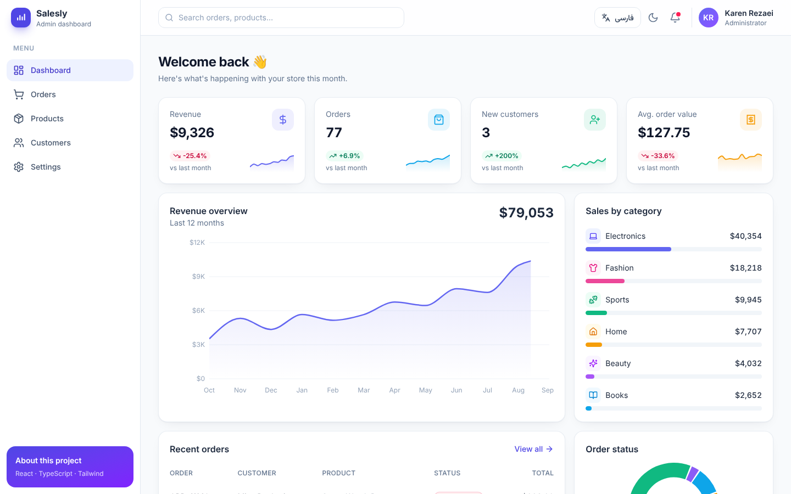
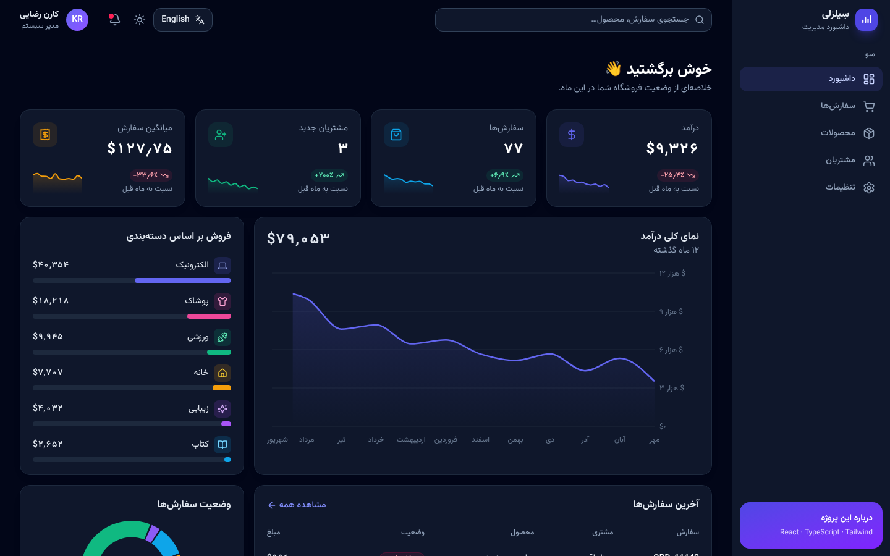
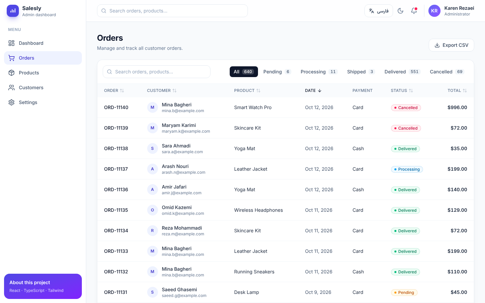
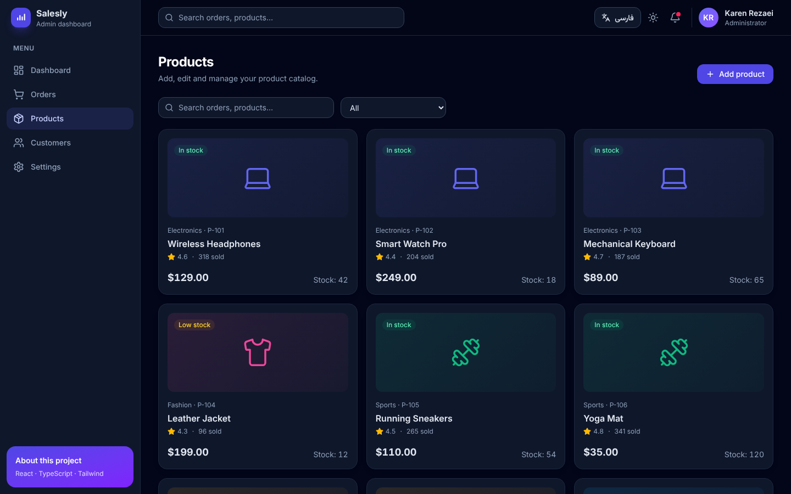
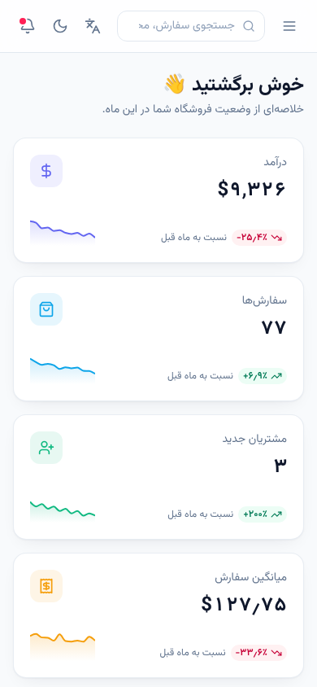

# Salesly — Sales Admin Dashboard

A responsive, bilingual (English / Persian **RTL**) admin dashboard for an online store, built with **React 19, TypeScript and Tailwind CSS 4**.



<table>
  <tr>
    <td></td>
    <td></td>
  </tr>
  <tr>
    <td></td>
    <td align="center"></td>
  </tr>
</table>

## ✨ Features

- **Dashboard** — KPI cards with trend sparklines, 12-month revenue chart, sales by category, order-status donut, recent orders and top products
- **Orders** — data table with global search, status filters (with counts), column sorting, pagination and **CSV export**
- **Products** — full CRUD (create / edit / delete) with form validation, confirmation dialog and toast notifications; changes persist in `localStorage`
- **Customers** — customer cards with order count and lifetime spend
- **Bilingual + RTL** — one-click switch between English (LTR) and Persian (RTL); layout, charts and pagination mirror correctly; Persian digits and Solar Hijri dates via `Intl`
- **Dark mode** — respects system preference, remembered across visits, no flash on load
- **URL state** — search and filters live in the query string (`/orders?q=sara&status=delivered`), so results are shareable and survive refresh
- **Responsive** — mobile drawer navigation, fluid grids, horizontally scrollable tables
- **Accessible** — semantic HTML, keyboard-friendly dialogs (Esc to close), `aria-sort`, `aria-live` toasts, focus styles, reduced-motion support
- **Performance** — route-level code splitting with `React.lazy` (charts load only on the dashboard)

## 🛠 Tech stack

| Area | Tools |
|---|---|
| Framework | React 19, TypeScript (strict) |
| Build | Vite 6 |
| Styling | Tailwind CSS 4 (logical properties for RTL) |
| Routing | React Router 7 |
| Charts | Recharts 3 |
| Tables | TanStack Table 8 (headless) |
| Icons / fonts | lucide-react, Inter, Vazirmatn (self-hosted via Fontsource) |

## 🚀 Getting started

Requires **Node.js 20+**.

```bash
npm install
npm run dev       # http://localhost:5173
npm run build     # type-check + production build into dist/
npm run preview   # serve the production build
```

## 📁 Project structure

```
src/
├─ components/
│  ├─ layout/      # AppLayout, Sidebar, Topbar
│  ├─ dashboard/   # KPI cards and charts
│  ├─ products/    # Product form
│  └─ ui/          # Reusable UI: Modal, Pagination, StatusBadge, …
├─ context/        # Settings (language/theme), products store, toasts
├─ data/           # Types and seeded sample data
├─ i18n/           # en.ts / fa.ts — type-checked translation keys
├─ lib/            # Formatting (Intl), statistics, CSV export
└─ pages/          # One file per route
```

## 💡 Implementation notes

- **Type-safe translations** — `fa.ts` must implement every key in `en.ts`, and `t('nav.ordrs')` is a compile-time error.
- **Deterministic sample data** — a seeded PRNG generates 640 orders, so charts look the same on every load. Swapping `src/data/mock.ts` for a real API is the only change needed to go live.
- **Logic separated from UI** — all statistics live in `src/lib/stats.ts` (no JSX), making them easy to test or replace.
- **No state library** — React Context + `useReducer` is enough for this scope.

## 📦 Deployment

Ready for [Vercel](https://vercel.com): import the repository and deploy. `vercel.json` rewrites all routes to `index.html` so deep links work.

---

Built by **Karen Rezaei** · Front-end developer
